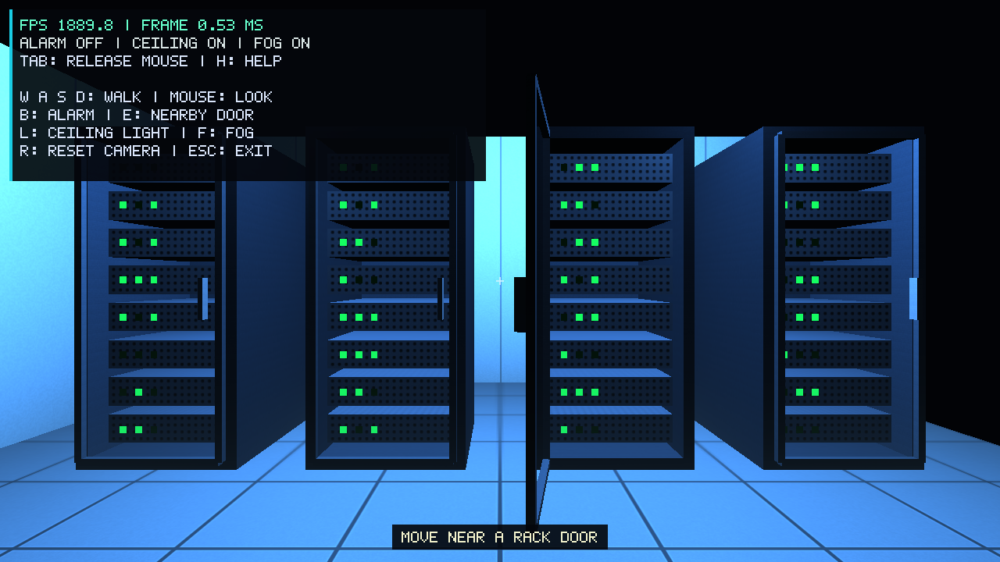

# Member 4: camera and interaction

The camera now moves inside the team's room. It starts at (0, 1.65, 3) and
looks along negative Z. The existing racks, lighting, textures, sound, and
FPS panel are used together.

## Code

- `Camera.h` and `Camera.cpp` store position, yaw, and pitch. Walking uses
  2.5 units per second multiplied by delta time. A normalized diagonal keeps
  the same speed. Walking changes X/Z but keeps the eye height at 1.65.
  Pitch stays between -89 and 89 degrees. A long frame is limited to 0.1 seconds
  for movement, so returning from a pause does not cause a large jump.
- `Camera::view()` uses lookAt. `projection()` uses a 60-degree vertical field
  of view and the current framebuffer width/height. Minimized windows pause
  rendering and timing.
- `Input.h` and `Input.cpp` own the GLFW key, mouse, button, and focus callbacks.
  Held keys control walking. New press events trigger the other actions once.
  Losing focus clears keys and releases the cursor. The first mouse position
  after capture is used as a reference, which avoids a sudden turn.
- `Interaction.h` selects the closest door within 2.3 units. The position comes
  from the rack's translation and rotation. E calls that rack's `toggle()`.
  The existing `Rack::update()` moves its door toward 0 or 100 degrees at
  90 degrees per second. Other doors keep their own state.
- `main.cpp` applies actions to lighting, fog, help, doors, and sound. B controls
  alarm because A is now used for walking. The Input object owns the window
  callback data, so the old help/audio callback no longer replaces it.
- `UI` shows the active controls, mouse capture state, and nearest door prompt.
  FPS and status remain visible when H hides the longer help list.

Collision detection is optional and is not implemented. The camera can pass
through room objects. R resets only the camera; it does not close doors or
change the lights.

## Controls

| Input | Action |
| --- | --- |
| W / A / S / D | Walk forward / left / back / right |
| Mouse | Look around while captured |
| Tab | Capture or release the mouse |
| Left click | Capture the mouse again |
| B | Toggle alarm |
| E | Toggle the nearest door when in range |
| L | Toggle ceiling lights |
| F | Toggle fog |
| H | Show or hide help |
| R | Reset the camera |
| Esc | Exit |

## Checks on 13 November 2026

The Windows Release build passed. All four CTest targets passed: camera,
interaction, performance, and audio synthesis. Camera tests compare travel at
30 and 144 FPS, diagonal speed, pitch limits, reset, and projection aspect.
Interaction tests check range, rotated rack positions, independent doors,
opening/closing, and invalid frame times.

`--smoke-test` runs the real window and registered callbacks. It checks press,
repeat and release, held W, mouse movement, focus loss, reset, help, resize,
and OpenGL state restoration. `--scene-smoke` uses the production frame loop:
it tries E from far away, walks to a rack, opens/closes/reopens one door,
toggles B/L/F/H, and resets the camera. Both runs passed without GL errors.

The live window was also checked with mouse-look, R, Tab, left click,
B, L, F, H, and Esc. The camera turned and reset, status labels followed the
scene, help hid while FPS stayed visible, and Escape closed with exit code 0.



Figure 1. Actual framebuffer capture at the end of the scene check. One door
is open, and the camera is reset. The cross at the center is the app's aim
marker, not a mouse pointer.

## Run and demonstrate

Use the README build commands. For a Visual Studio build:

```powershell
.\build\Release\OpenGLApp.exe
ctest --test-dir build -C Release --output-on-failure
.\build\Release\OpenGLApp.exe --smoke-test
.\build\Release\OpenGLApp.exe --scene-smoke
```

For Ninja use `build/OpenGLApp.exe`; for macOS use `./build/OpenGLApp`.

For a short demo, show the help panel, walk with WASD, and slowly turn the
mouse. Approach a rack until E appears in the bottom prompt. Open it, wait,
then close it. Press B twice and L twice. Hide help with H and point out that
FPS is still visible. Release the mouse with Tab, resize, click to resume,
and reset with R. Record the actual program when making the team video.

## Performance

These runs use the current racks, walking-camera start position, and sound.
The older UI-stage results used a different camera and scene, so they are
not a direct speed comparison. Each new run used 1280x720, fog and help on,
VSync off, a two-second warmup, and a 30-second sample. The runs were sequential.

System: Windows 11 Pro, Intel Core i5-12450HX, 15.7 GiB RAM. OpenGL reported
NVIDIA GeForce RTX 4050 Laptop GPU/PCIe/SSE2, OpenGL 3.3.0 NVIDIA 617.14.
Normal interactive use has VSync on and was observed near 144 FPS.

| Mode | Frames | Sample | Mean FPS | p95 frame time | Longest frame |
| --- | ---: | ---: | ---: | ---: | ---: |
| Normal | 54093 | 30.000 s | 1803.086 | 0.790 ms | 4.466 ms |
| Alarm | 53753 | 30.000 s | 1791.754 | 0.781 ms | 2.701 ms |
| Ceiling off | 54636 | 30.000 s | 1821.182 | 0.767 ms | 3.170 ms |

All samples completed. Raw results: [normal](evidence/member4-complete/normal.json),
[alarm](evidence/member4-complete/alarm.json), and
[ceiling off](evidence/member4-complete/ceiling-off.json).
These are local measurements and do not predict results on other computers.

The scene issues separate draw calls for rack parts, panels, and LEDs.
The rendering owner can profile these if a more detailed room becomes slow.
No profiler result is available, so this is a possible cost rather than a
confirmed bottleneck.
