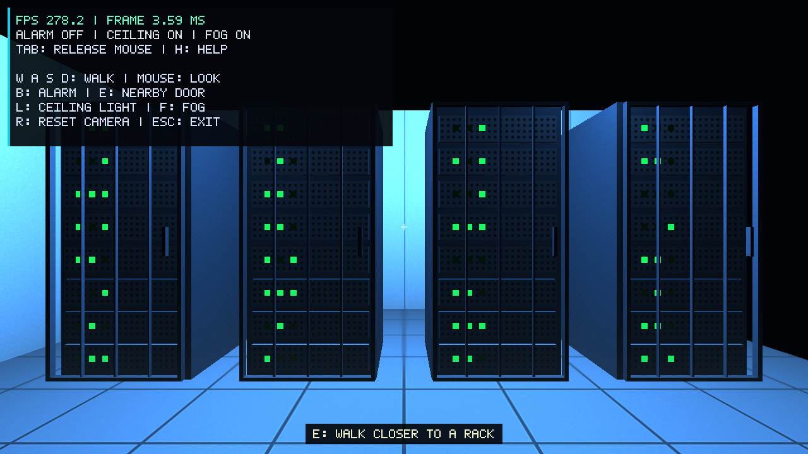
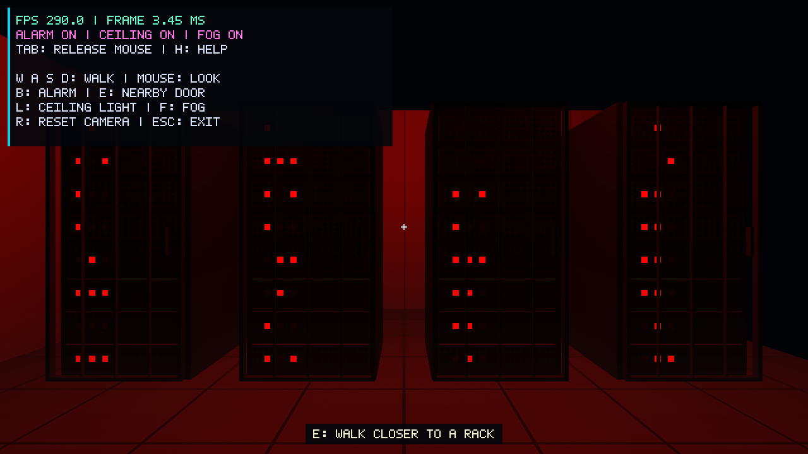
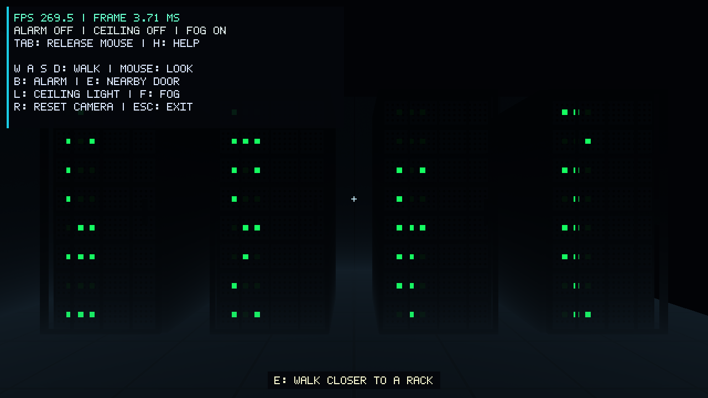

# Member 4: controls, camera, UI and performance

## What this part adds

The old scene had one fixed camera. This part adds walking and mouse look.
It also connects the alarm, ceiling lights and nearby rack doors to keyboard
input. Help and FPS are drawn inside the window, so the controls are visible
without opening the README.

The alarm key is B. The old A key is now used for walking left. E opens or
closes the nearest door within 2.3 world units. L changes the ceiling lights.
F keeps the existing fog control. H hides help but keeps FPS and mode labels.
Tab releases the mouse. Clicking captures it again. R resets only the camera.

## Camera and input

`Camera::move` multiplies direction by speed and delta time. A diagonal
direction is normalized, so W+D is not faster than W. Walking changes X and Z;
the eye stays at height 1.65. The maximum movement time step is 0.1 seconds,
which limits a jump after a long pause. This clamp is not used for FPS data.

Mouse movement changes yaw and pitch. Pitch stays between -89 and 89 degrees.
`view()` looks from the eye toward eye + forward. `projection()` uses the
current framebuffer width divided by height. A minimized window skips rendering
and timing. Collision detection is not part of this contribution.

`Input` owns the GLFW user pointer and keyboard, cursor, focus and mouse-button
callbacks. Toggle keys react to a press, not key repeat. Focus loss clears held
keys and releases the mouse. The first mouse position after capture is saved
without rotating the view. This prevents a sudden jump.

## Door integration

`RackDoors` keeps four independent open states. The closest rack front is
selected from the camera position. A door rotates about its left hinge from
0 to -105 degrees at 140 degrees per second. It is a simple metal frame with
bars, so the existing server LEDs remain visible. Member 2 can replace this
frame with the final model while keeping the same interaction.

## UI and measurements

The HUD uses a small 5-by-7 bitmap font and separate OpenGL 3.3 shaders. It shows
FPS, frame time, alarm/light/fog states, help, and a nearby-door prompt. H hides
only the longer controls list. Static text geometry is kept until its displayed
content or size changes. The UI restores the scene's OpenGL state after drawing.

Displayed FPS is frames divided by elapsed time over about 0.5 seconds.
Benchmark mode uses the same formula over a longer sample. It disables VSync,
waits two seconds, and then records 30 seconds. It also stores p95 frame time
and the longest frame. The p95 value means that 95% of measured frames were
no slower than that time.

## Recorded performance

Measured on 3 November 2026, Release build, 1280x720 framebuffer, fog and HUD on,
fixed starting camera, VSync off. Each row is one 30-second run after a two-second
warmup. Raw files are in `evidence/`.

System: Intel Core i5-12450HX, 15.7 GiB RAM, Windows 11 Pro. Windows lists Intel
UHD Graphics and NVIDIA RTX 4050 Laptop GPU. The actual OpenGL renderer string
for these runs is **Intel UHD Graphics 770**, OpenGL 3.3, driver 32.0.101.7026.
The driver name is recorded as returned; these are not RTX 4050 measurements.

| Scene mode | Mean FPS | p95 frame time | Longest frame | Frames |
|---|---:|---:|---:|---:|
| Normal | 268.345 | 4.727 ms | 1044.283 ms | 8051 |
| Alarm on | 288.904 | 4.510 ms | 135.790 ms | 8668 |
| Ceiling off | 289.233 | 4.609 ms | 152.510 ms | 8677 |
| Normal, separate repeat | 210.665 | 7.832 ms | 15.590 ms | 6320 |

The separate normal run had no frame longer than 15.590 ms. The first three
runs still show occasional stalls on this desktop. Their cause has not been
profiled. These results do not prove a stable
minimum frame rate or performance on the TA computer. Retest there at 1280x720.

One code-level performance concern is the number of small scene draws: about
167 per frame, with repeated uniform lookups. The renderer/Shader owner can
profile these calls and consider uniform caching or instancing. No measured
GPU bottleneck is claimed here.

## Rendering evidence

The following PNGs are lossless conversions of actual OpenGL framebuffer
captures. They include the on-screen FPS and contain no mouse pointer.

Figure 1. Normal blue lighting, help, FPS, and the nearby-door prompt.

Figure 2. Red alarm mode using the existing lighting and LED shaders.

Figure 3. Ceiling lights off; emissive LEDs remain visible.

## Verification

Local camera tests passed for equal walking distance at 30 and 144 updates per
second, diagonal speed, pitch limits, reset, pause clamping, and aspect ratio.
FPS tests passed for warmup, frames/elapsed-time calculation, p95, invalid time
values, and measurement completion. The local door test executable was blocked
by Windows Application Control; it is not counted as a local pass.

The real application completed its OpenGL smoke run with no reported GL error.
The same run invoked the installed input callbacks and checked held W movement,
press/repeat/release actions, focus-loss cleanup, first-mouse handling, rotation
after clicking while captured, and reset. These are automated callback checks,
not a claim that a human walked the whole room during this run.
The visible B and L toggles changed the rendered lighting. H removed the help
list while FPS stayed visible. Escape ended the application with exit code 0.
The GitHub workflow separately builds and runs the three calculation test
programs on Windows and macOS; its status is available on the pull request.

## Scope and handoff

This is the Member 4 contribution, not a claim that all team requirements are
finished. Other owners still provide the final room model, scene hierarchy,
lighting/material documentation, and their report sections. The team must
assemble the final PDF, slides and 3–6 minute video, add the TA, and create v1.0
on the actual submission date. See `member4-video.md` for the recording sequence.

AI use: OpenAI Codex assisted with the camera and input code, HUD, door
integration, tests, build setup and this text. The main changes replace the
fixed camera, move alarm to B, add visible controls, and record actual FPS.
