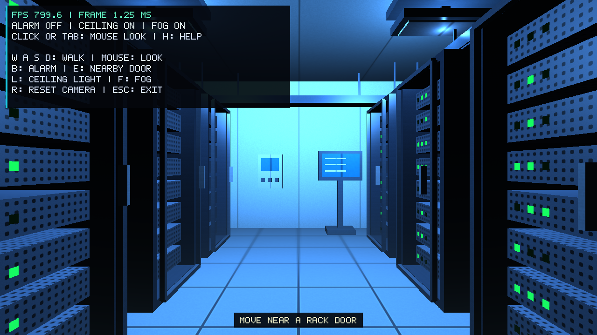
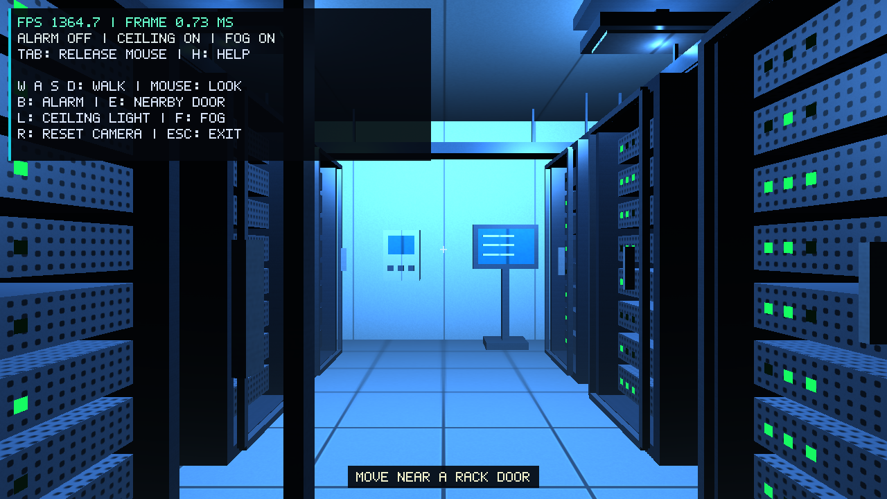
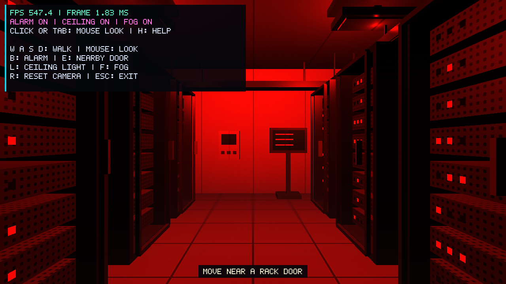

# Member 2: room layout and geometry

Implemented on 13 November 2026, starting from team main `b86803f`.
The tested code revision is `133ef874d575f6cbf61b227cd7f3adb86ccb6f4a`.

The incoming version already contained the shared Mesh renderer, the Rack model,
door animation, camera, input, lighting, textures, fog, audio and HUD. Those
modules are retained. This work adds the room layout, equipment, cable trays,
explicit face UVs and geometry checks.

## Scene construction

`Scene` creates six persistent racks. Their centres are at x = -2.4 and 2.4,
with z = -3, -1 and 1 in each row. Rotations of +90 and -90 degrees turn their
fronts toward the central aisle. Rack IDs 0-5 give the existing LED shader
different identifier ranges. Each rack still has eight units and 24 LEDs.

| Object | Construction and location |
| --- | --- |
| Server rack | Reused frame, server units, LED faces and hinged door; two rows of three |
| Ceiling fixture | Mount, support, housing and pale diffuser above each existing light position |
| Cooling unit | Tall cabinet with nine vent louvers and a small display, in the back-left corner |
| Monitor | Base, upright stand, screen frame and three static status lines, near the back wall |
| Control panel | Separate wall-mounted enclosure, display and three buttons |

The floor remains 10 by 8 scene units. Three walls and a ceiling enclose the
room, while the front stays open. Camera controls and the start position are
unchanged. Walk to the back-left side to inspect the cooling unit.

The cable trays run above both rows at about y = 3.3. Each has a bottom,
side rails, crosspieces, ceiling supports and three simple cable runs. The
rear tray joins the rows. All parts reuse the cube mesh; no geometry is
uploaded in the frame loop. Cable trays and the existing tiled floor form
one stretch feature, while the existing cold-air fog is the other.

## Transforms and geometry

The implementation uses GLM matrices, ordinary loops and a `vector<Rack>`.
For column vectors, the existing rack hierarchy is:

```text
rackWorld = Translate(rackPosition) * RotateY(rackRotation)
serverWorld = rackWorld * Translate(serverOffset)
doorPartWorld = rackWorld * Translate(hinge) * RotateY(-doorAngle)
              * Translate(partCentre) * Scale(partSize)
clipPosition = projection * view * model * localPosition
```

The rightmost operation acts first. Door parts are expressed relative to the
hinge, so turning a rack also turns its hinge, servers and LEDs. The existing
E action selects a nearby rack; `Scene::update(dt)` updates the same rack
objects that are drawn and shown in the HUD. Door speed and the 0-100 degree
limits remain in Rack.

`Geometry.cpp` creates 24 vertices and 36 indices: four separate vertex records
per face preserve sharp normals and independent UVs. Negative-axis faces now
reverse their triangle winding so that the cross product points outward.
The +Z face remains indices 30-35, preserving the LED quad draw range.

The shared vertex format is position, normal and UV, at shader locations 0, 1
and 2. UVs cover [0,1] on each face. The lit vertex shader subtracts 0.5 and
multiplies by face dimensions and `repeatPerUnit`, preserving the previous
box-mapping texture scale on stretched or rotated parts. Image loading,
mipmaps, lighting equations and fog were not replaced.

Relevant lecture material, using PDF page numbers:

- `L-9_HierchModels (1)-3.pdf`, pp. 17-24: articulated parent-child transforms.
- `L-5-1_Viewing-4.pdf`, pp. 26-27, 46-47: model/view/projection. GLM matrices
  continue to use `GL_FALSE` in the existing Shader upload.
- `L-5-2_Shading-4.pdf`, pp. 33-35, 42: cross products and unit normals.
- `L-8_TextureMapping-3.pdf`, pp. 25-33, 43-46: vertex texture coordinates.

## Verification

Release builds completed both in a new `build/member2` directory and in the
usual `build` directory. The first GLFW archive download was interrupted;
the official GLFW and GLM archives were downloaded again and their SHA256
values matched the hashes already pinned by the team before configuring.
No dependency versions or build download rules were changed.

All five CTest targets passed: geometry, camera controls, interactions,
performance statistics and audio synthesis. Added checks cover outward
triangle winding, non-collapsed UV triangles, the retained LED draw range,
door selection in both rotated rows, unique rack IDs and independent updates.

Both `--smoke-test` and `--scene-smoke` completed without OpenGL errors. These
exercise the existing keyboard/mouse callbacks, window resize, HUD state
restoration, walking, door opening/closing and B/L/F/H actions. The check now
waits for window focus before testing input on macOS. Automated runs disable
framebuffer scaling to measure exactly 1280x720 on Retina; normal interactive
use keeps the high-resolution framebuffer.

The live application was also inspected using walking, E, R, H, Tab and B.
The cooling unit, monitor, control panel, fixtures and tray structure were
visible, and the alarm changed the room from blue to red. Mouse callback
behaviour is covered by the automated input check.

## Performance on the local laptop

Hardware: Apple A18 Pro, 8 GiB RAM. System: macOS 27.0.1 (26A434).
OpenGL reports `Apple A18 Pro`, `4.1 Metal - 91.7`.
Each sequential run used the fixed starting view, 1280x720, fog and help on,
VSync off, a two-second warmup and a 30-second sample. All samples completed.

| Mode | Mean FPS | p95 frame time, ms | Max frame time, ms | Raw result |
| --- | ---: | ---: | ---: | --- |
| Normal | 1256.036 | 1.104 | 12.524 | [normal.json](evidence/member2-scene/normal.json) |
| Alarm | 1167.033 | 2.195 | 9.642 | [alarm.json](evidence/member2-scene/alarm.json) |
| Ceiling off | 1121.105 | 2.316 | 10.233 | [ceiling-off.json](evidence/member2-scene/ceiling-off.json) |

These are local measurements of the expanded scene, not results from the TA
machine or a new Windows run. Normal interactive use has VSync enabled.

## Captures and reproduction







These are actual framebuffer captures. To repeat the checks on macOS:

```sh
cmake -S . -B build -DCMAKE_BUILD_TYPE=Release
cmake --build build --parallel
ctest --test-dir build --output-on-failure
./build/OpenGLApp --smoke-test
./build/OpenGLApp --scene-smoke
./build/OpenGLApp --benchmark normal --output build/normal.json
```

The monitor is static. Collision detection remains outside this change, so
the existing camera can pass through objects. The figures and explanations
can be used in Member 2's report section; the final report and presentation
still need to be assembled in the course formats.
