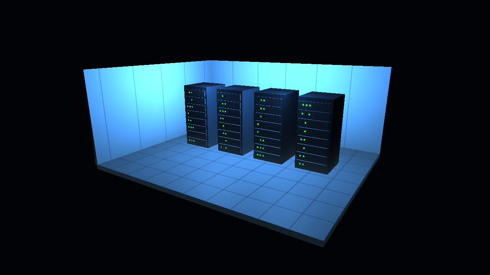

# Texturing and cold-air atmosphere

## Rendering
Four 128 × 128 monochrome images modulate material albedo before the existing
Blinn–Phong lighting calculation. The metal has the sharpest highlight and the
painted wall the broadest. Textures are uploaded once. Both axes repeat, with
linear magnification and trilinear minification across generated mip levels.

## UVs and floor integration
For each box face the vertex shader selects its two tangent axes and scales
local coordinates by the corresponding model-axis lengths. A floor tile spans
one scene unit in both horizontal directions, even on a rectangular slab.
The pattern origin is the mesh center. For adjoining floor slabs, align their
centers on whole tile intervals or use a shared UV origin. The existing cube
contract is position at location 0 and face normal at location 1. Imported or
curved meshes will need authored UVs. Member 2 can place cable trays over the
tiled surface. The combined stretch goal requires those trays in the scene.

## Cold-air fog
Both fragment shaders mix their shaded or emissive surface color toward a
cool haze (muted red in alarm mode). The blend grows with camera distance and
decays exponentially above floor level. This approximates a shallow cold-air
layer at low cost. F toggles it independently of the ceiling lights and alarm.

## Evidence for the team report
Capture normal and alarm views with identical framing, then a fog-off view.
Include a close view of the tile seams and perforations and a distant view
for filtering. Record the actual hardware, resolution and measured FPS in
the team report. The course report template and Member 2 tray mesh were not
present in the source branch.

Figure 1. Application capture at 1280 × 720, with ceiling lights and cold-air
fog enabled. CMake build and the four-frame OpenGL smoke test passed in Ubuntu
under WSL using Xvfb.
