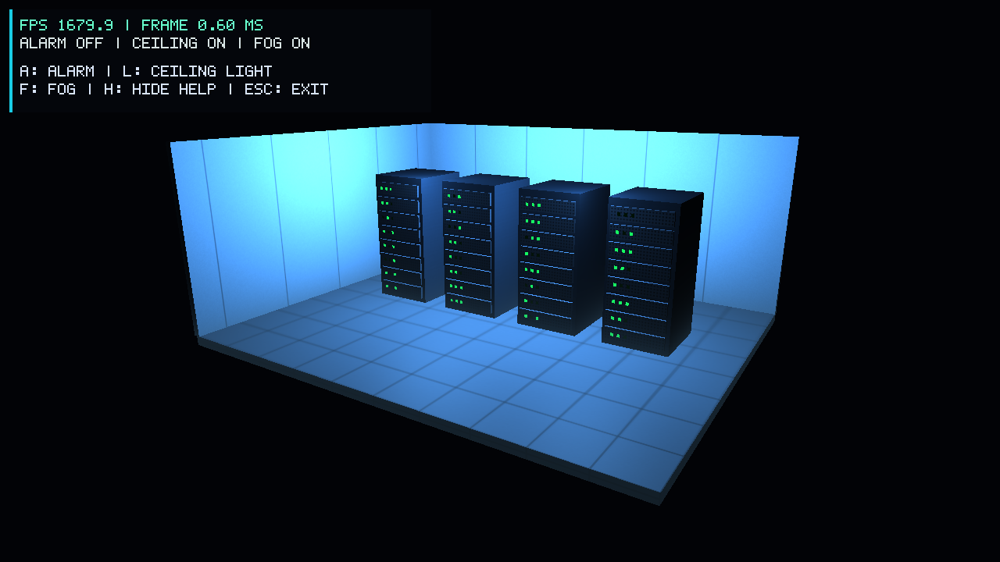
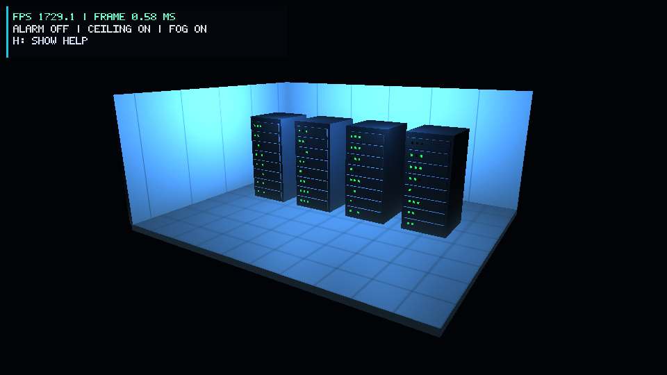

# Member 4: UI and performance

The first stage added FPS to the window title. This stage adds an on-screen
panel and a timed benchmark. It uses the team's current Mesh class and GLAD 2
setup. Walking, mouse look, and nearby-door controls are planned for the next
stage. The camera is still fixed.

## Files and controls

`UI.h` holds the panel state. `UI.cpp` draws letters from a small 5x7 bitmap
font using colored triangles. `ui.vert` and `ui.frag` draw the panel after the
room. The panel follows the framebuffer size. It saves and restores the OpenGL
program, buffers, blending, and depth settings.

The panel shows FPS, frame time, and the alarm, ceiling light, and fog states.
A toggles the alarm, L toggles the ceiling lights, and F toggles fog. These
three scene controls already existed in the team code. H hides or shows the
help lines; it keeps FPS and status visible. Escape closes the program.
The H callback only handles a new press, so key repeat does not toggle help.

`PerformanceStats` updates the display about every half second:

```text
FPS = frames / elapsed seconds
frame time = 1000 * elapsed seconds / frames
```

The existing `bool addFrame(double)` interface is kept. A true result means
the displayed average has changed. Invalid or non-positive time values are
ignored. A benchmark skips a two-second warmup and records 30 seconds of frame
times. It reports mean FPS, p95 frame time, and the longest frame. The p95 value
is the frame time at position ceil(0.95 * frame count) in the sorted sample.
Exiting early produces `complete: false`. Minimizing pauses measurement.

## Real captures



Figure 1. The running program at 1280x720. This capture was made during a
separate warmup. Its rolling FPS value is not the full benchmark average.



Figure 2. The smoke test hid help and resized the running window to 960x540.
FPS and status remain visible. Both images are actual framebuffer captures.

## Checks on 10 November 2026

- Release build with GCC and the pinned GLFW, GLM, and GLAD dependencies: passed.
- CTest performance checks: passed. These cover rolling averages, invalid
  input, warmup, sample completion, restart, and p95 calculation.
- Real OpenGL smoke test: passed. It rendered the scene and HUD, changed
  alarm/light/fog state, and reported no OpenGL errors.
- The smoke test called the registered H handler with press, repeat, and
  release actions. Help changed only on press, then returned on a second press.
- The window changed from 1280x720 to 960x540 and back. Both HUD sizes rendered.
- The smoke test checked that the HUD restored the scene program, VAO, depth
  test, depth writes, and disabled blending before the next scene frame.
- The two captured frames above were checked visually.

These were automated checks of the handler and rendering. Manual keyboard
input was not verified in this session because the desktop automation runtime
could not start. To check it manually, press H twice, then A, L, and F. Check
that the corresponding labels and scene effects change. Press Escape to close.

## Performance setup

Measured on Windows 11 Pro with an Intel Core i5-12450HX and 15.7 GiB RAM.
OpenGL reported NVIDIA GeForce RTX 4050 Laptop GPU/PCIe/SSE2 and
`3.3.0 NVIDIA 617.14`. Each mode ran separately with a 1280x720 framebuffer,
fixed camera, fog and help visible, and VSync off. No screenshots were saved
during these timing runs. Normal interactive use has VSync on.

| Mode | Frames | Sample | Mean FPS | p95 frame | Longest frame |
| --- | ---: | ---: | ---: | ---: | ---: |
| Normal | 67014 | 30.000 s | 2233.783 | 0.653 ms | 3.554 ms |
| Alarm | 66231 | 30.000 s | 2207.680 | 0.688 ms | 2.330 ms |
| Ceiling off | 66763 | 30.000 s | 2225.424 | 0.677 ms | 2.622 ms |

Raw results: [normal](evidence/ui-fps-stage2/normal.json),
[alarm](evidence/ui-fps-stage2/alarm.json), and
[ceiling off](evidence/ui-fps-stage2/ceiling-off.json).
All three samples completed. These are local results for the current simple
room. They do not predict performance on another computer or the final model.

## Run

Build with the commands in the README. For a Visual Studio build:

```powershell
.\build\Release\OpenGLApp.exe
ctest --test-dir build -C Release --output-on-failure
.\build\Release\OpenGLApp.exe --smoke-test
.\build\Release\OpenGLApp.exe --benchmark normal --output normal.json
.\build\Release\OpenGLApp.exe --benchmark alarm --output alarm.json
.\build\Release\OpenGLApp.exe --benchmark ceiling-off --output ceiling-off.json
```

For Ninja builds the executable is `build/OpenGLApp.exe`. On macOS it is
`./build/OpenGLApp`. Run benchmarks one at a time, without resizing or changing
scene settings. Optional `--capture frame.ppm` saves a framebuffer image once
after one second. Convert that PPM to PNG if needed for a report.

The room still makes many small draw calls for server panels and LEDs. This
is a possible place for the rendering owner to investigate if a larger scene
becomes slow. It has not been confirmed as a bottleneck by a profiler.
