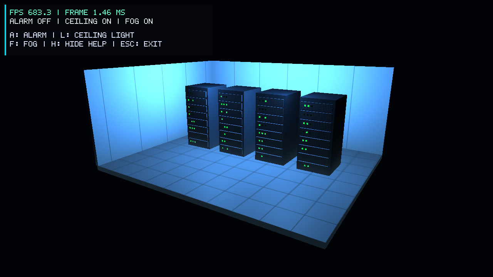

# Member 4: UI and FPS

This stage adds the help panel and performance data to the existing room.
The fixed camera, lighting, textures, and fog come from the current team scene.
Walking, mouse look, and door controls are the next stage.

## Implementation

`UI` draws a small bitmap font with separate OpenGL shaders. FPS, frame time,
and alarm/light/fog states stay visible. H hides the longer help list. The
panel lists A, L, F, H, and Esc because these are the controls in this version.
Its size follows the framebuffer size. The draw call restores the previous
OpenGL state so the overlay does not change scene rendering.

`PerformanceStats` counts frames and elapsed time. About every half second,
it updates these values:

```text
FPS = frames / seconds
frame time in ms = 1000 * seconds / frames
```

The benchmark turns VSync off, skips a two-second warmup, then measures 30
seconds. It records mean FPS, p95 frame time, and the longest frame. A minimized
window pauses rendering and measurement. An early exit is marked incomplete.
The optional frame capture happens during benchmark warmup, before sampling.

H uses a press callback and ignores key repeat. The existing A/L/F/Esc polling
uses GLFW sticky keys, so a short press is kept until the program reads it.

## Recorded run

Measured on 3 November 2026: Release build, normal mode, fixed camera,
1280x720 framebuffer, fog and help on, VSync off. The final timing run did not
save an image while measuring.

System: Intel Core i5-12450HX, 15.7 GiB RAM, Windows 11 Pro. The actual driver
reported `Intel(R) UHD Graphics 770`, OpenGL `3.3.0 - Build 32.0.101.7026`.
The renderer name is copied as returned by OpenGL.

| Sample | Frames | Mean FPS | p95 frame time | Longest frame |
|---|---:|---:|---:|---:|
| 30.001 seconds | 20402 | 680.043 | 2.005 ms | 6.624 ms |

Raw result: [normal.json](evidence/ui-fps/normal.json). This is one local run;
it does not predict performance on the TA computer or on the final room model.
Normal interactive use has VSync on, so its FPS can be lower.



Figure 1. Actual framebuffer capture from a separate normal-mode run. The
number on screen is a short rolling average, not the full benchmark average.

## Checks

- Release build and the `performance_tests` CTest passed.
- Unit checks cover FPS, frame time, invalid time values, warmup, p95,
  completion, and restarting a sample.
- The real OpenGL smoke run completed without a reported GL error.
- In the live window, H hid help while keeping FPS and status visible.
- A, L, and F updated the scene and the corresponding HUD labels.
- Escape closed the application with exit code 0.

The scene makes many small draw calls and uploads view/projection values for
each object. The renderer owner can check uniform caching or shared updates
if the final scene becomes slower. This is a code-level concern, not a measured
bottleneck in this run.

## Run

Use the README build instructions, then run:

```powershell
.\build\OpenGLApp.exe
.\build\OpenGLApp.exe --smoke-test
.\build\OpenGLApp.exe --benchmark normal --output normal.json
ctest --test-dir build --output-on-failure
```
